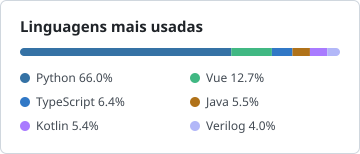

# Thiago Cordeiro de Melo

### Engenharia de Computação · Universidade do Estado do Amazonas

Avaliação de LLMs · Visão computacional · Aprendizado de máquina

  
  

---

## Sobre mim

Sou graduando em Engenharia de Computação na Escola Superior de Tecnologia da UEA, em Manaus, e estagiário de AI Quality Assurance no INDT.

No estágio, testo modelos de linguagem de texto e imagem (LLMs e LMMs) antes de irem para produção. Automatizo os testes e procuro alucinações, respostas inconsistentes e tentativas de burlar as regras do sistema. Também criei um agente avaliador, um LLM que dá notas às respostas de outro modelo e aponta o que foi alucinado.

Antes disso, trabalhei com visão computacional, em reconhecimento de placas veiculares, e com aprendizado de máquina sobre dados clínicos. Na iniciação científica (PIBIC), comparo CNNs na detecção de câncer renal em tomografias.

Fora do trabalho, construo aplicações que usam LLMs em tarefas do dia a dia, como um bot que registra gastos a partir de texto, áudio ou foto de comprovante.

## Projetos em destaque

<table>
<tr>
<td width="50%" valign="top">

### Leve: gastos por mensagem

**LLM multimodal · Aplicação completa**

Bot do Telegram ligado a um app de controle de gastos. A pessoa manda texto, áudio ou foto de um comprovante de Pix, cupom ou boleto, e o modelo extrai os lançamentos. Também responde a perguntas como "quanto ainda posso gastar?" e aceita correções ("na verdade foi 35").

O LLM só interpreta o pedido e redige a resposta. Somas e limites são calculados pelo código, com as mesmas regras do app, para evitar números inventados.

**Tecnologias:** API de LLM, TypeScript, Supabase (Postgres, Auth e Edge Functions) e Telegram Bot API.

</td>
<td width="50%" valign="top">

### Câncer renal em tomografias

**Pesquisa · Visão computacional**

Compara arquiteturas de CNNs pré-treinadas na classificação de tomografias renais entre normal e tumor, testando técnicas de realce de contraste no pré-processamento. A melhor combinação passou de 99% de acurácia, e o trabalho virou artigo no CBEB 2026.

**Tecnologias:** Python, PyTorch, TorchVision e OpenCV.

</td>
</tr>

<tr>
<td width="50%" valign="top">

### Detecção em partidas de futebol

**Visão computacional · Detecção e segmentação**

Detecção de objetos e segmentação de instâncias em imagens de partidas de futebol. O modelo reconhece jogadores, árbitros, bola e elementos do campo.

**Tecnologias:** Python, Ultralytics YOLO e Jupyter.

</td>
<td width="50%" valign="top">

### Predição de rating em reviews

**Processamento de linguagem natural**

Prevê a nota de uma review a partir do texto. Extraí atributos léxicos e de sentimento das reviews e treinei um classificador com eles.

**Tecnologias:** Python, scikit-learn, pandas e Jupyter.

</td>
</tr>
</table>

### Outros projetos

- [Raças de cães com CNN](https://github.com/thiagocordeirum/TopicosI-A3-CNN): classificação de imagens entre raças visualmente parecidas.
- [Filtro de Sobel](https://github.com/thiagocordeirum/TopicosI-A1-FiltroSobel): extração de bordas como vetor de características.
- [MLP para classificação de renda](https://github.com/thiagocordeirum/TopicosI-A2-MLP): comparação de arquiteturas de redes neurais.
- [CNN para o MNIST](https://github.com/thiagocordeirum/MNIST-CNN-Arquitecture): classificação de dígitos manuscritos.
- [AMpolo](https://github.com/thiagocordeirum/soros-spd): sistema para acompanhar a distribuição de soros antivenenos no Amazonas, com Vue, TypeScript e Python.
- [Circuitos aritméticos em Verilog](https://github.com/thiagocordeirum/verilog-arithmetic-projects): ULA, multiplicador e divisor de 8 bits com testbenches.

---

## Experiência

### INDT · Estagiário de AI Quality Assurance

Abr. 2026 – atual

- Desenvolvi testes ponta a ponta para recursos de IA generativa que rodam no celular, como resumo de notificações e transcrição e resumo de notas de voz, com Python e PyTest em execução paralela em vários aparelhos, o que permite validar cada nova versão do modelo de forma repetível.
- Criei cenários de prompt injection a partir de um dataset de entradas adversariais, verificando a integridade das respostas e o vazamento das instruções do sistema, para encontrar falhas de segurança antes da produção.
- Construí um agente avaliador (LLM como juiz) rodando localmente com Ollama e saída estruturada validada com Pydantic, que dá notas por critério e aponta alucinações, substituindo a revisão manual das respostas e gerando relatórios quantitativos e qualitativos usados para aprovar versões dos modelos.

### Sentinela · Bolsista de visão computacional e IA

Nov. 2025 – mar. 2026

- Desenvolvi um sistema de reconhecimento automático de placas veiculares (ALPR) para imagens e vídeos com Python e YOLO, automatizando a identificação de veículos.
- Implementei as etapas de pré-processamento e segmentação com OpenCV, preparando as placas detectadas para a leitura dos caracteres.
- Integrei um OCR especializado em placas à saída do detector, entregando o texto da placa pronto para uso pelo restante do sistema.

### Dialog · Bolsista de desenvolvimento de software e IA

Fev. 2025 – nov. 2025

- Desenvolvi modelos de aprendizado de máquina para predição e classificação em dados clínicos sequenciais com Python, scikit-learn e pandas, apoiando a pesquisa em saúde do projeto.
- Tratei e pré-processei os dados clínicos armazenados em PostgreSQL, deixando as bases prontas para treino e avaliação dos modelos.
- Implementei e mantive serviços REST com Kotlin, Spring Boot e Docker, usados pela plataforma do projeto.
- Dei suporte aos pacientes participantes no uso dos dispositivos e nas medições, contribuindo para a qualidade dos dados coletados.

### Iniciação científica (PIBIC) · EST/UEA

Orientação: Prof. Dr. Wheidima Carneiro de Melo

- Montei um pipeline de treino e avaliação de CNNs pré-treinadas com PyTorch e transfer learning, permitindo comparar arquiteturas nas mesmas condições e com resultados reproduzíveis.
- Testei técnicas de realce de contraste no pré-processamento com OpenCV, chegando a mais de 99% de acurácia na classificação de tumores renais em tomografias.
- Escrevi e apresentei o artigo com esses resultados no CBEB 2026.

---

## Publicação

**Análise comparativa de arquiteturas de CNNs com técnicas de pré-processamento para classificação de câncer renal em imagens tomográficas.** XXX Congresso Brasileiro de Engenharia Biomédica (CBEB 2026).

## Conquistas

- Olimpíada Iberoamericana de Matemática Universitária (2024): único convocado do Amazonas, medalha de participação.
- World Mathematics Invitational, Fukuoka, Japão (2019): Merit Medal.

---

## Tecnologias e ferramentas

**IA e dados**

 

  

**Desenvolvimento**

  

**Dados e infraestrutura**

---

## GitHub

---

Thiago Cordeiro de Melo · Engenharia de Computação · UEA

